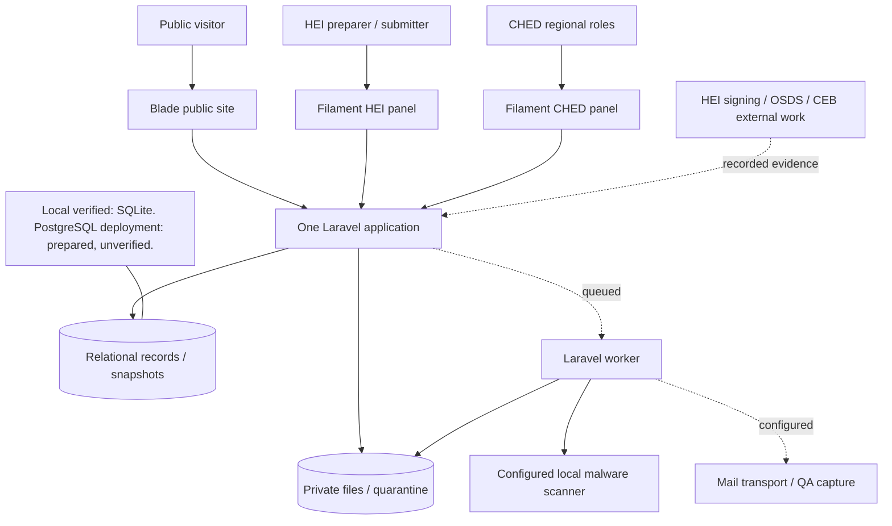
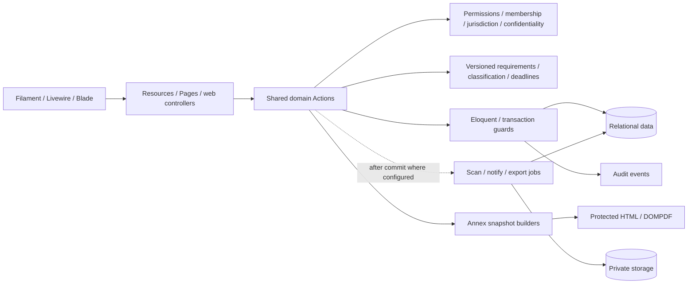
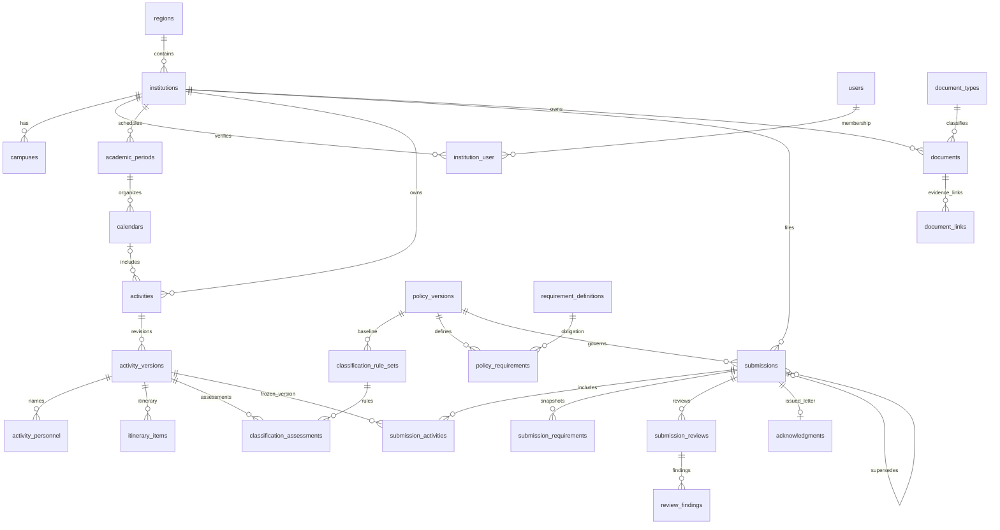
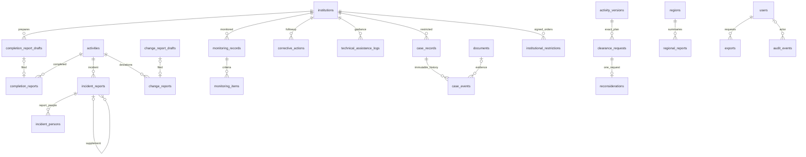
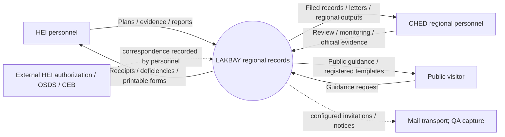
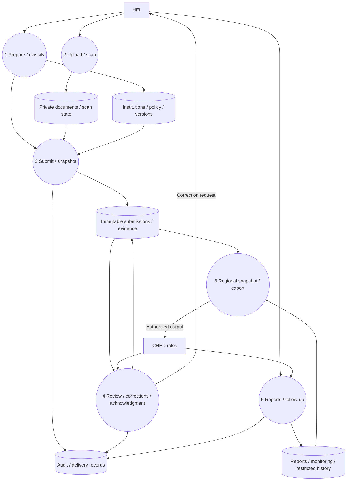
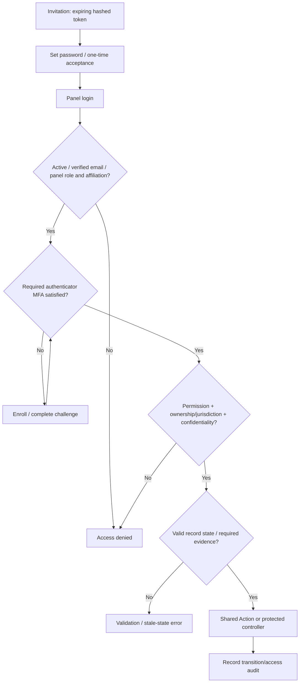
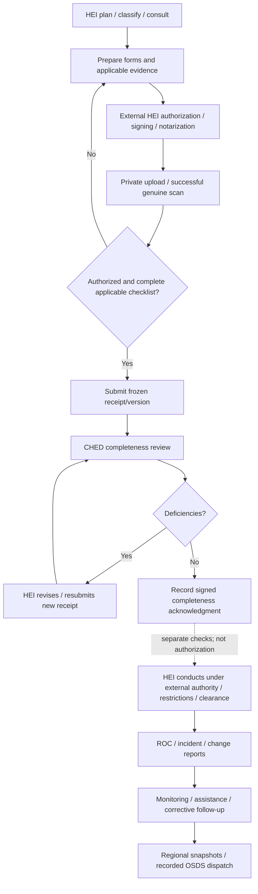
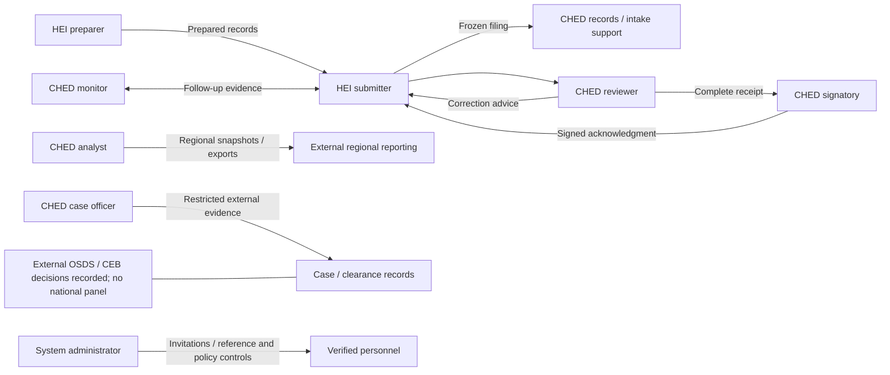
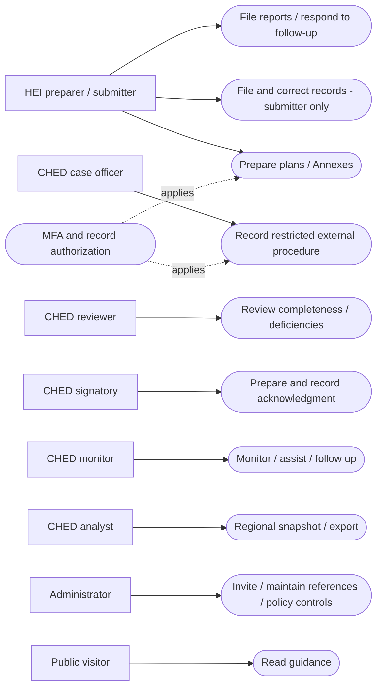

# Editable system diagrams

> Evidence snapshot: 12 October 2026; application commit `741f29d`. Documentation-only audit; no FIX-06 implementation, policy activation, data mutation or new dependency.

Diagrams represent the current source baseline; they do not certify deployed infrastructure. Solid paths represent application functions. Dashed paths represent queued/configured or externally performed work. The diagram source files in `diagrams/` are editable Mermaid. The use-case model additionally has formal PlantUML source; its Mermaid companion is a readable use-case map, not native UML notation.

## Diagram index

| Diagram | Editable source | Meaning |
|---|---|---|
| High-level architecture | [architecture.mmd](diagrams/architecture.mmd) | Public/HEI/CHED entry points, application, records and private files |
| Component architecture | [components.mmd](diagrams/components.mmd) | UI → Actions → rules/access → storage/jobs |
| Core ERD | [erd-core.mmd](diagrams/erd-core.mmd) | Identity, versions, receipts, requirements and evidence |
| Operational ERD | [erd-operations.mmd](diagrams/erd-operations.mmd) | Reports, monitoring, restricted cases and clearance |
| DFD context / Level 0 | [dfd-0.mmd](diagrams/dfd-0.mmd) | External actors and whole application boundary |
| DFD Level 1 | [dfd-1.mmd](diagrams/dfd-1.mmd) | Preparation, filing, review, after-activity and records |
| Authentication/authorization | [auth.mmd](diagrams/auth.mmd) | Identity, MFA and record-level access checks |
| End-to-end workflow | [end-to-end.mmd](diagrams/end-to-end.mmd) | Institutional preparation through regional follow-up |
| Cross-role interaction | [cross-role.mmd](diagrams/cross-role.mmd) | Which responsibilities exchange records |
| Use cases | [use-cases.mmd](diagrams/use-cases.mmd), [use-cases.puml](diagrams/use-cases.puml) | Current actors and system capabilities |
| Submission sequence | [sequence-submission.mmd](diagrams/sequence-submission.mmd) | Validation, rollback, snapshot, review/corrections |
| Upload sequence | [sequence-upload.mmd](diagrams/sequence-upload.mmd) | Quarantine, scan failure, authorized retrieval |
| Case sequence | [sequence-case.mmd](diagrams/sequence-case.mmd) | External stage validation and historical gaps |
| Nine role flows | `diagrams/role-*.mmd` | Individual journeys; links in the role document |

ERDs deliberately omit some columns and infrastructure pivots for readability; the generated [complete column/FK dictionary](05-database-and-data-flow.md) supplies the full inspected QA schema. JSON references are identified as application references rather than invented database foreign keys.

Mermaid diagrams are embedded below for supporting Markdown viewers. Offline HTML/PDF exports include simple architecture/workflow visuals; rendering every Mermaid/UML diagram into images was not available without an additional renderer. No renderer or dependency was installed.

## Architecture



## Components



## Erd Core



## Erd Operations



## Dfd 0



## Dfd 1



## Auth



## End To End



## Cross Role



## Use Cases



## Sequence Submission

```mermaid
sequenceDiagram
 actor HEI as Authorized HEI submitter
 participant UI as Filament/Livewire
 participant Act as SubmitActivity
 participant Rule as Access / PolicyRules / Resolver
 participant DB as Database
 HEI->>UI: File applicable stage and evidence
 UI->>Act: execute(selected versions, policy, evidence)
 Act->>DB: Begin transaction / lock records
 Act->>Rule: Verify membership, state, eligible policy and completeness
 alt Invalid or stale
 Rule-->>Act: Validation / denial
 Act->>DB: Rollback
 Act-->>UI: Error; no filed revision
 else Valid
 Act->>DB: Freeze receipt, versions, evidence and annex payloads
 Act->>DB: Audit / commit
 Act-->>UI: Receipt and follow-up notice
 end
 actor Reviewer as CHED reviewer
 Reviewer->>UI: Review exact receipt
 UI->>DB: Record findings / review transition via Action
 alt Corrections
 UI-->>HEI: Deficiency advice
 HEI->>Act: Resubmit new revision
 else Complete
 UI-->>Reviewer: Complete; signatory step remains separate
 end
```

## Sequence Upload

```mermaid
sequenceDiagram
 actor User as Authorized uploader
 participant App as UploadDocument
 participant Store as Private storage
 participant DB as Document records
 participant Worker as ScanDocument job
 participant Scanner as Configured scanner
 User->>App: Valid file and metadata
 App->>Store: Store private bytes
 App->>DB: Pending scan / hash / confidentiality
 App-->>Worker: Queue scan
 Worker->>Scanner: Scan resolved local path
 alt Scanner fails or infection found
 Worker->>DB: Preserve quarantine / infected state
 User->>App: Attempt retrieval
 App-->>User: Denied until clean
 else Genuine successful scan and hash match
 Worker->>DB: Clean
 User->>App: Preview / download
 App->>DB: Recheck access and scan state; audit
 App->>Store: Retrieve authorized bytes
 App-->>User: Protected response
 end
 Note over App,Store: Fresh generic retrieval hash check remains FIX-08
```

## Sequence Case

```mermaid
sequenceDiagram
 actor Officer as CHED case officer
 participant UI as Restricted case form
 participant Act as RecordCaseEvent
 participant DB as Case / evidence / events
 Officer->>UI: Stage, actual time, evidence and particulars
 UI->>Act: execute with replay key
 Act->>DB: Regional/confidential access, lock case, inspect prior evidence
 alt New decision missing required stages
 Act-->>UI: Validation failure; no event
 else Explicit historical external record with explanation
 Act->>DB: Preserve missing-stage snapshot and actual date
 else Complete valid stage
 Act->>DB: Append immutable event and audit
 end
 Act-->>UI: Recorded timeline; no automatic restriction
 Note over Officer,DB: External Committee/CEB work and HEI service are recorded, not performed
```
