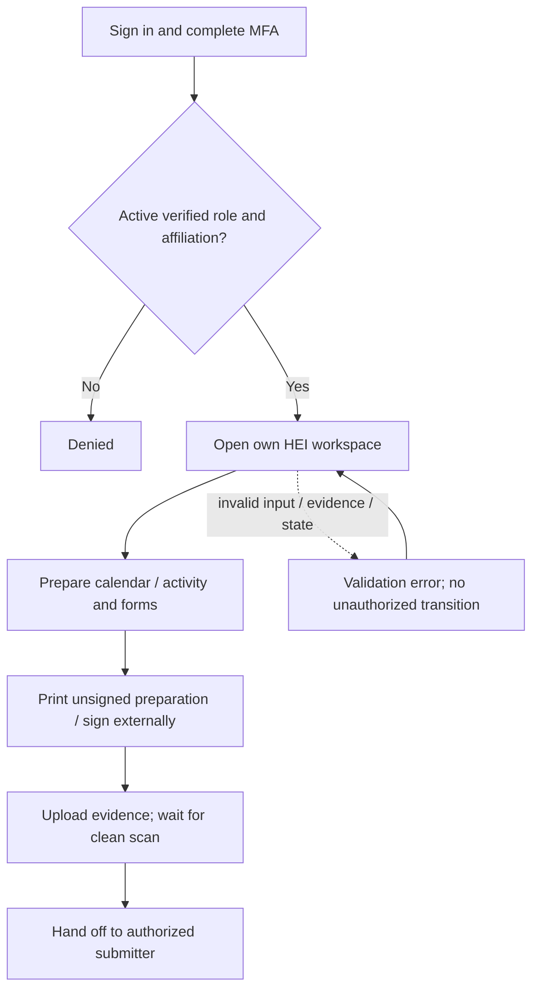
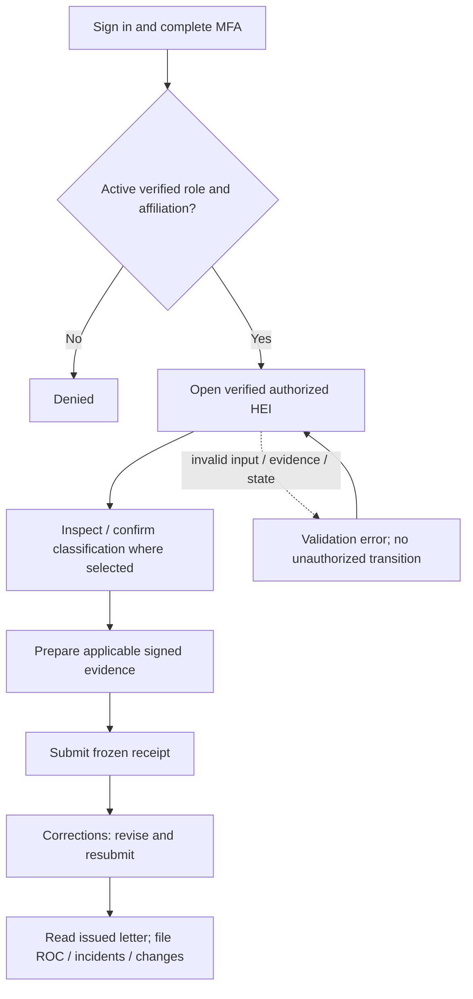
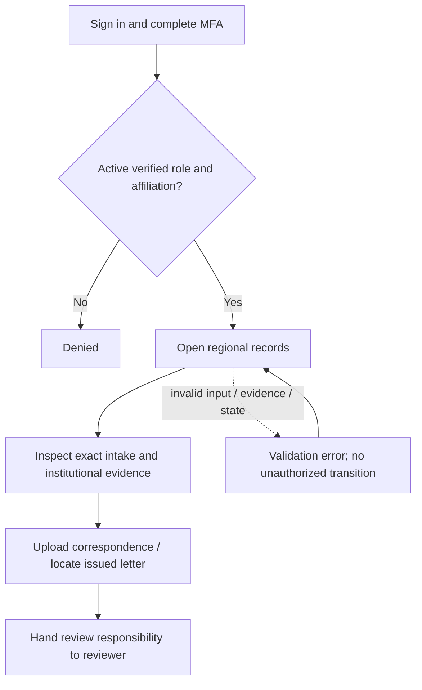
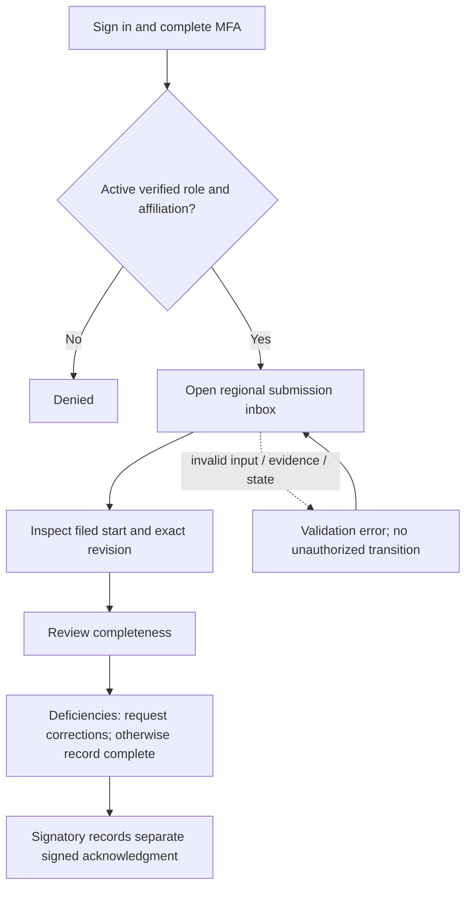
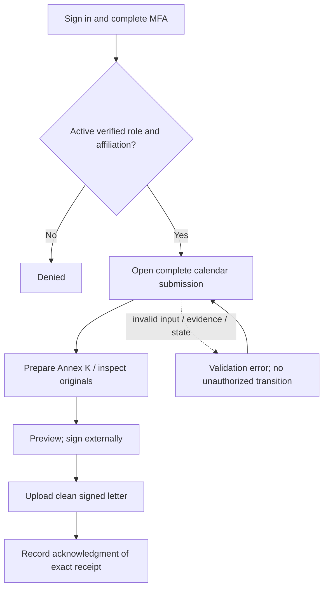
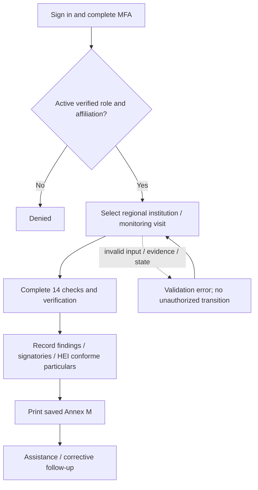
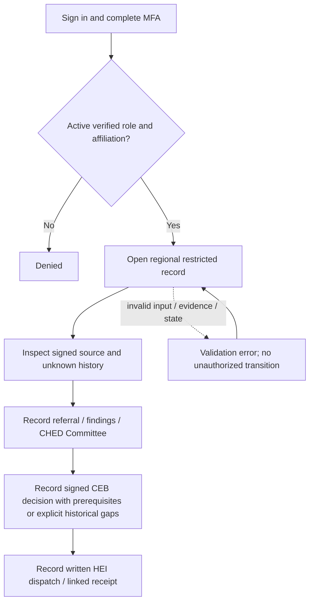
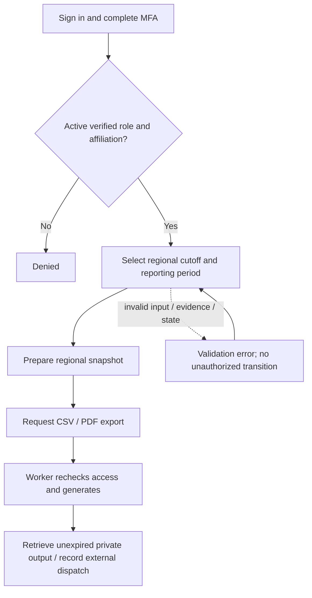
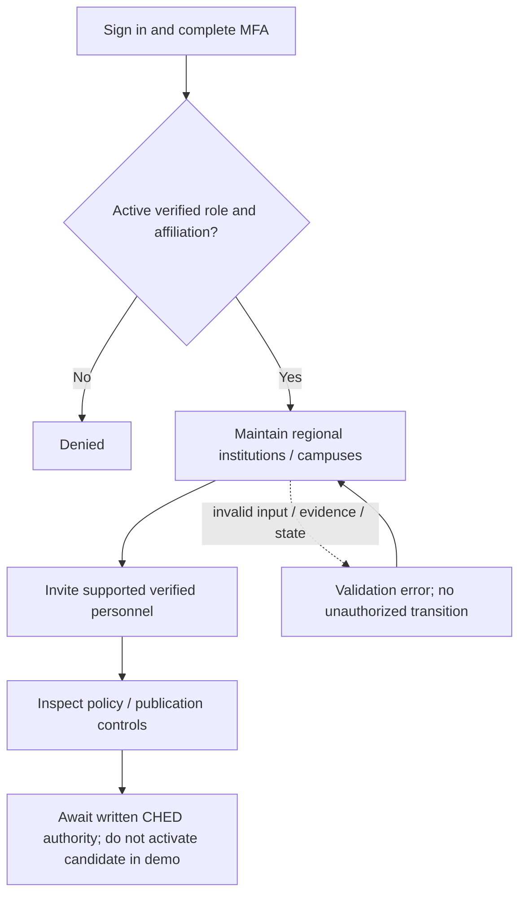

# Actual roles, permissions and journeys

> Evidence snapshot: 12 October 2026; application commit `741f29d`. Documentation-only audit; no FIX-06 implementation, policy activation, data mutation or new dependency.

The seed defines **nine roles**. Public visitors are an actor, not a stored role. Role grants below are the seeded defaults, not a claim that every deployed user has only one role. Verified institutional membership/submitter authority or CHED region, email verification, active account, MFA, record state and confidentiality apply in addition to role permissions.

Evidence: `database/seeders/DatabaseSeeder::run`; `User::canAccessPanel`; `Access::{owns,regional,authorize,document}`; `InstitutionRecordPolicy::view`; `ScopedResource`; `WorkflowUi::actions`. A hidden button is not the security boundary: shared Actions and download controllers enforce access.

## User journeys

| Role | Responsibility and step-by-step journey | Limits and interactions |
|---|---|---|
| `hei_preparer` | Accept invitation → choose own HEI → create academic period/calendar/activity → complete Annex B–F/J inputs → preview/print → upload signed/ordinary evidence → check scan state | Can prepare/upload; cannot file submissions/reports. Hands prepared records to authorized HEI submitter. Approval/signing remain outside app. |
| `hei_submitter` | Prepare or inspect HEI plans → confirm saved classification where selected → attach applicable evidence → submit → read correction → revise/resubmit → receive acknowledgment → file completion/incident/change information → respond to follow-up | Must have authorized verified membership. Ordinary Category 3 SAA is excluded; escalated Category 3 has Category 2 treatment. No access to CHED restricted cases. |
| `ched_records` | Sign in → open regional intake/records → inspect filed snapshots and institutional documents → upload correspondence/evidence → locate issued letters | Read/upload support; no seeded review/signatory/monitor/case/export privilege. Cannot replace immutable filed originals. |
| `ched_reviewer` | Sort submission inbox by filed date → inspect exact revision/checklist → review completeness → request specific correction or record complete → review resubmission/evidence response | Completeness review, not activity approval. Does not issue signed acknowledgment with this role alone; confidential incidents/cases excluded. |
| `ched_signatory` | Open complete calendar package → prepare Annex K addressee/date/Director details → inspect originals → preview → sign externally → upload clean signed acknowledgment → record issue | Seeded role can issue acknowledgment, not perform review. Coordination with reviewer is required. No automatic notarization/signing. |
| `ched_monitor` | Select regional institution → create monitoring visit → complete 14 Annex M checks/verification/findings/signatories/conforme particulars → print → record assistance/corrective follow-up | Rating is human-entered operational information, not automatic sanction. HEI follow-up is separately recorded. No restricted-case authority. |
| `ched_case_officer` | Open regional restricted case → record signed source/referral/findings/Committee/CEB evidence → record HEI dispatch/receipt → review unknown historical flags; record external clearance/reconsideration when authorized | Requires `cases.sensitive`; incident access uses `incidents.view`. Complaint does not create suspension. FIX-06 routing completeness is pending. Cross-region transfer not granted by referral. |
| `ched_analyst` | Open regional reporting → select period/cutoff → prepare snapshot → request CSV/PDF → worker generates → retrieve authorized unexpired export → record external dispatch/receipt where supported | Summed student participations, not distinct students. Monitoring narrative/dispatch association gap remains FIX-07. No case evidence/incident narrative access. |
| `system_administrator` | Maintain regional institution/campus records → invite verified personnel → assign supported role/membership → inspect policy controls → await documented CHED/publication authority before confirmation | No seeded restricted-case, review, issue, monitor or export power. Do not activate candidate during demo. Invitation acceptance creates account; MFA enrollment follows. |

All users encounter alternatives: invalid inputs retain a draft/show errors; unauthorized access is denied; missing scan blocks retrieval; stale/duplicate transition is rejected where guarded; corrections create another receipt rather than editing the old one. HEI execution is externally authorized and readiness is separate from acknowledgment.

## Seeded RBAC matrix

The permission matrix below is generated directly from the role seed. `Y` means a seeded grant only; an accessible action still needs ownership/jurisdiction and its other guards. Ordinary regional read access excludes sensitive/restricted content unless the explicit additional permission applies.

| Role | panel.hei | records.view | activities.manage | documents.upload | submissions.submit | reports.submit | panel.ched | submissions.review | acknowledgments.issue | monitoring.manage | cases.sensitive | incidents.view | reports.export | institutions.manage | users.invite | policy.manage |
|---|---|---|---|---|---|---|---|---|---|---|---|---|---|---|---|---|
| hei_preparer | Y | Y | Y | Y | — | — | — | — | — | — | — | — | — | — | — | — |
| hei_submitter | Y | Y | Y | Y | Y | Y | — | — | — | — | — | — | — | — | — | — |
| ched_records | — | Y | — | Y | — | — | Y | — | — | — | — | — | — | — | — | — |
| ched_reviewer | — | Y | — | Y | — | — | Y | Y | — | — | — | — | — | — | — | — |
| ched_signatory | — | Y | — | Y | — | — | Y | — | Y | — | — | — | — | — | — | — |
| ched_monitor | — | Y | — | Y | — | — | Y | — | — | Y | — | — | — | — | — | — |
| ched_case_officer | — | Y | — | Y | — | — | Y | — | — | — | Y | Y | — | — | — | — |
| ched_analyst | — | Y | — | — | — | — | Y | — | — | — | — | — | Y | — | — | — |
| system_administrator | — | Y | — | — | — | — | Y | — | — | — | — | — | — | Y | Y | Y |

### hei_preparer

[Editable flow](diagrams/role-hei_preparer.mmd).

### hei_submitter

[Editable flow](diagrams/role-hei_submitter.mmd).

### ched_records

[Editable flow](diagrams/role-ched_records.mmd).

### ched_reviewer

[Editable flow](diagrams/role-ched_reviewer.mmd).

### ched_signatory

[Editable flow](diagrams/role-ched_signatory.mmd).

### ched_monitor

[Editable flow](diagrams/role-ched_monitor.mmd).

### ched_case_officer

[Editable flow](diagrams/role-ched_case_officer.mmd).

### ched_analyst

[Editable flow](diagrams/role-ched_analyst.mmd).

### system_administrator

[Editable flow](diagrams/role-system_administrator.mmd).
